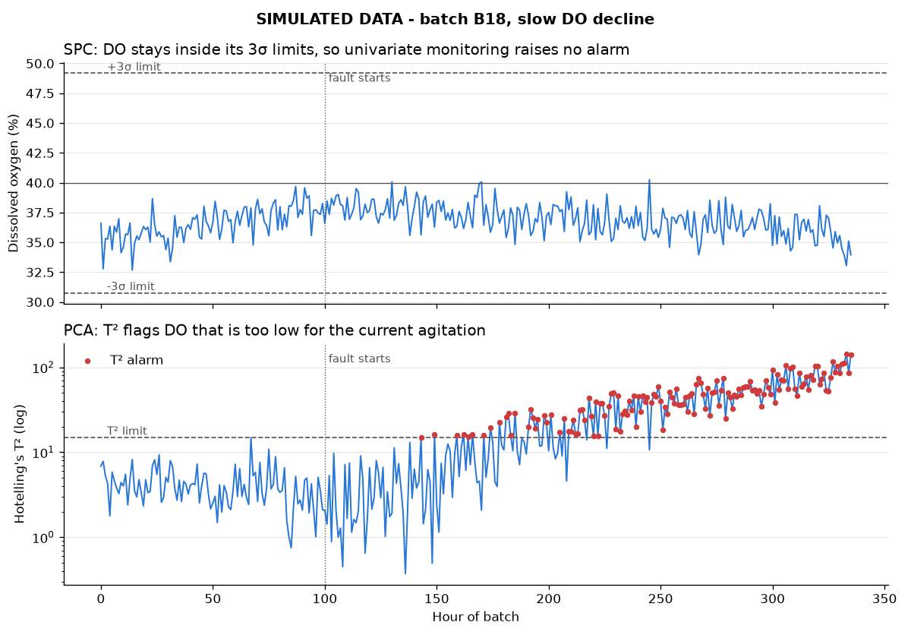

# Bioreactor Batch Monitor (SIMULATED data)

> **All data in this project is simulated.** It is not connected to any real process.

## 1. Purpose

This project monitors bioreactor batches for process faults. It simulates 20
14-day cell-culture batches (pH, temperature, dissolved oxygen, agitation),
stores them in SQLite, and flags abnormal readings two ways: **univariate SPC**
(each sensor against its own ±3σ control limits) and **multivariate PCA**
(Hotelling's T², which catches sensors that each look normal but don't fit
together). It then checks itself against 3 faults injected on purpose.

## 2. Intended use

**Decision support only. A person reviews every alert.** The monitor never
changes the process and never makes a release decision. It points an engineer
at the batch, hour and sensor worth a closer look.

## 3. Data (simulated)

| Item | Value |
|---|---|
| Batches | 20 (B01–B20), 14 days each, hourly readings = 336 rows per batch |
| Sensors | pH (~7.0), temperature (~37 °C), DO (~40 %), agitation (100 → 140 rpm ramp) |
| Built-in relationship | DO rises with agitation (faster stirring dissolves more oxygen) |
| Reference set | B01–B10: known-good historical batches, used **only** to learn limits |
| Monitored set | B11–B20: "new" batches checked against those limits |
| Injected faults | B12 temperature drift (+0.24 °C/day from hour 150) · B15 pH spike (+0.3 for 6 h at hour 200) · B18 slow DO decline (−1 %/day from hour 100) |

The fault labels are stored in the `batches` table as ground truth for scoring
only. The monitoring code never reads them.

## 4. Method

1. **Store and query with SQL.** Two tables, `batches` and `sensor_readings`.
   Queries use `JOIN` (readings plus batch info), `GROUP BY` (per-batch summary)
   and the window function `LAG` (hour-to-hour pH change, which puts the B15
   spike at the top of the list).
2. **Univariate SPC.** For each sensor: limits = mean ± 3σ computed **from the
   reference batches only**. If a faulty batch were included, its bad values
   would inflate σ and widen the limits, so the monitor would learn to accept the
   fault (a test shows this).
3. **Multivariate PCA.** Standardise the 4 sensors, fit PCA on reference data,
   and compute Hotelling's T² for every hour. The alarm limit is the 99.73rd
   percentile of T² on good data, which gives the same expected false-alarm rate
   as 3σ. All 4 components are kept. The smallest one (1.3 % of variance) is
   the DO–agitation relationship, and that is exactly where the DO fault shows up.
4. **Alerts.** Every flagged reading goes to `outputs/alerts.json` as
   `{batch, hour, sensor, value, limit, method}`.
5. **Validation.** Alarms are scored against the injected faults. An alarm counts
   as *true* if it is in a faulty batch, during the fault window, on the faulty
   sensor (any PCA alarm in the window counts, because T² covers all sensors).

## 5. Test results

`pytest -v` gives **6 passed**. From `python run.py`, monitored batches B11–B20:

| Metric | Result |
|---|---|
| Faults caught | **3 of 3** (recall 100 %) |
| True alarms / false alarms | 459 / 20 |
| Precision (share of alarms that were real) | **95.8 %** |
| False-alarm rate on good batches | 13 alarms in 11,760 checks (7 batches × 336 h × 5 checks) ≈ **0.11 %** |

The other 7 false alarms are in faulty batches but outside the fault window or
on the wrong sensor. The rate is below the ~0.27 % that 3σ predicts per check,
because DO and agitation follow a bounded ramp rather than a bell curve, so
they almost never cross their limits by chance.

| Fault | Starts | First SPC alarm | First PCA T² alarm |
|---|---|---|---|
| B12 temperature drift | hour 150 | hour 175 | hour 175 |
| B15 pH spike | hour 200 | hour 200 | hour 200 |
| B18 DO decline | hour 100 | **never** | **hour 143** |

The key finding is B18. DO never leaves its own ±3σ band, so SPC is silent.
But DO is too low *for the current agitation*, so T² catches it 43 hours after
it starts. See `outputs/control_chart_B18.png`:



## 6. Limitations

- **Simulated data.** Real data has missing values, sensor calibration drift,
  batch-phase changes and non-Gaussian noise. None of that is modelled here.
- **Small reference set.** Only 10 good batches, from the same simulator as the
  test batches, so the results are optimistic.
- **One limit for the whole batch.** Real batches go through phases (lag,
  exponential growth, stationary), so limits should change with batch time.
  This is done with batch-wise unfolding (MPCA) or time-aligned limits.
- **No run rules.** Every single point outside the limits alarms. Western
  Electric / Nelson rules (e.g. "2 of 3 points beyond 2σ") would cut false
  alarms and catch slow drifts earlier.
- **T² doesn't say which sensor.** A contribution plot would show which
  sensor(s) drove each PCA alarm.
- **Threshold from the same data it was fit on.** It is an empirical percentile,
  not the F-distribution limit used in textbooks.

## 7. Next steps

1. Replace the simulator with real historian data (e.g. AVEVA/OSIsoft **PI**)
   for a set of released batches.
2. Phase- or time-aligned limits (MPCA), an SPE/Q residual statistic, run rules
   and contribution plots.
3. Treat it as a GxP computerised system: requirements, risk assessment,
   IQ/OQ/PQ-style validation (GAMP 5), change control.
4. Add an **audit trail** (21 CFR Part 11 / EU Annex 11): who reviewed each
   alert, when, and what they decided.

---

## Tools and libraries

| Tool | Why |
|---|---|
| **numpy** | Fast arrays for simulating sensor signals and the T² maths |
| **pandas** | Tables (DataFrames) to move data between Python and SQL |
| **sqlite3** | Built into Python. A real SQL database in a single file, no server needed |
| **scikit-learn** | `StandardScaler` and `PCA`: well-tested, standard implementations |
| **matplotlib** | Saves the control chart as a PNG |
| **pytest** | Runs the validation tests with one command |

## File structure

```
bioreactor-batch-monitor/
├── run.py            # One command runs everything; prints results, saves JSON + chart
├── simulate.py       # Generates the SIMULATED batches and injects the 3 faults
├── database.py       # SQLite schema + SQL queries (JOIN, GROUP BY, LAG)
├── monitor.py        # SPC control limits and PCA / Hotelling's T² monitoring
├── evaluate.py       # Scores alarms vs injected faults: precision, recall, first alarm
├── tests/
│   └── test_monitor.py   # 6 validation tests
├── outputs/
│   ├── alerts.json            # All alerts (batch, hour, sensor, value, limit, method)
│   ├── control_chart_B18.png  # SPC vs PCA chart for the DO-decline batch
│   └── bioreactor.db          # SQLite database (generated, not committed)
├── pytest.ini        # Tells pytest to import modules from the project folder
├── requirements.txt  # Python packages
├── .gitignore        # Keeps secrets, caches and the .db out of git
└── README.md         # This file
```

## Setup

```bash
conda create -n bioreactor-batch-monitor python=3.12 -y
conda activate bioreactor-batch-monitor
pip install -r requirements.txt
```

## How to run

```bash
python run.py      # whole pipeline, about 2 seconds
pytest -v          # 6 validation tests
```

## How it was built

1. Simulated normal batches with a fixed random seed, then injected 3 faults with known start hours.
2. Designed a 2-table SQLite schema and loaded the data.
3. Wrote SQL queries: JOIN to split reference vs new batches, GROUP BY summary, LAG for sudden changes.
4. Computed ±3σ control limits from the reference batches and flagged readings outside them.
5. Fitted StandardScaler + PCA on the reference batches, computed T², set the limit at the 99.73rd percentile.
6. Wrote alerts to JSON and drew the SPC-vs-T² chart for B18.
7. Scored alarms against ground truth (precision, recall, first alarm hour) and wrote pytest tests.

## Key concepts

- **Control limits (±3σ):** if the process is normal and roughly Gaussian, 99.73 % of readings fall inside. A point outside is unlikely to be normal noise.
- **Phase I vs Phase II SPC:** Phase I = learn limits from known-good data. Phase II = monitor new data against them. Mixing them up hides faults.
- **Why multivariate:** sensors are correlated. A reading can be normal for each sensor alone but abnormal as a combination (DO OK, but too low for this agitation).
- **PCA:** rotates correlated sensors into uncorrelated components. **Hotelling's T²** is a distance from "normal" that accounts for those correlations.
- **Standardising:** without it, the sensor with the biggest units (rpm) would dominate PCA.
- **Precision vs recall:** precision = how many alarms were real (alarm fatigue). Recall = how many faults we caught (missed problems). In GMP, a missed fault is usually worse, but too many false alarms get alarms ignored.
- **Ground truth via simulation:** injecting known faults is how you can measure detection at all. Real plant data rarely comes with labels.
- **Decision support, not control:** a person reviews every alert. That keeps the human accountable, which matters in a regulated (GMP) setting.
